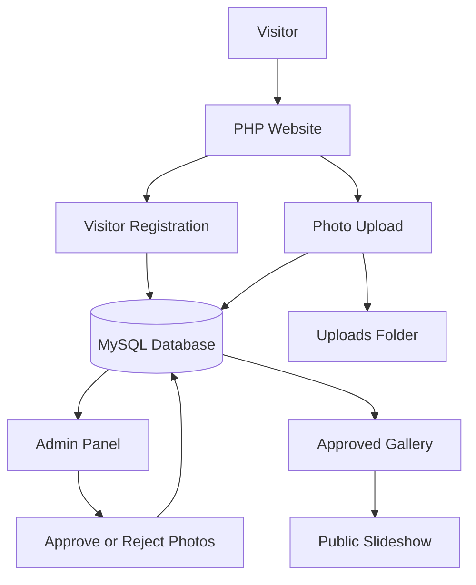

## Main components
- `index.php`: visitor-facing registration, upload, and photo-history interface.
- `api/`: PHP endpoints for visitor identification, photo upload, visitor history, and approved gallery data.
- `admin/`: administrator authentication and photo moderation.
- `display.php`: full-screen slideshow for approved photos.
- `assets/`: CSS and JavaScript used by the website.
- `database/schema.sql`: MySQL database and table definitions.
- `config/db.php`: local database connection file (create it by copying `config/db.example.php`; it is intentionally excluded from Git).
- `uploads/photos/`: runtime storage for visitor-uploaded images; uploaded images are intentionally excluded from Git.

## Data flow
1. Visitor identifies themselves and receives or reuses a visitor profile.
2. Uploaded images are validated and stored; each photo is recorded as `pending`.
3. An administrator approves or rejects each photo.
4. Public gallery and slideshow endpoints return approved photos only.
5. Visitors can retrieve their own upload history and moderation statuses.

## Technology Stack and Reasons

| Technology | Purpose | Reason |
|---|---|---|
| HTML | Website structure | Simple page structure |
| CSS | Website styling | Custom and responsive design |
| JavaScript | Interactive features | Handles slideshow and user interactions |
| PHP | Backend | Handles registration, uploads and admin operations |
| MySQL | Database | Stores visitor and photo information |
| XAMPP | Local server | Easy local development and testing |

## System Architecture Diagram

## Database Design

### Main Tables

- **visitors:** Stores visitor ID, name, visitor token and timestamps.
- **photos:** Stores visitor ID, photo path, file details and approval status.
- **admins:** Stores administrator login details.

### Relationships

- One visitor can upload multiple photos.
- Each photo belongs to one visitor.
- Admins manage photo approval and rejection.
- Only approved photos are displayed in the public gallery.
